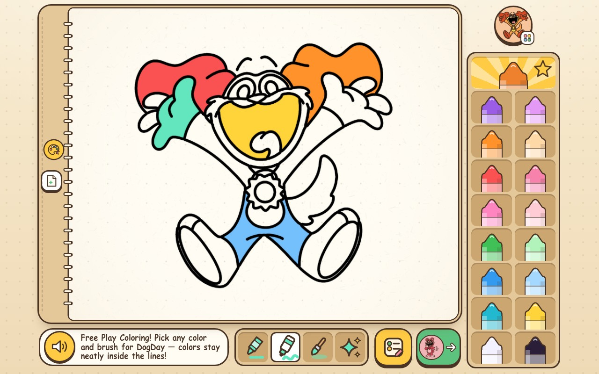

# 🎨 Smiling Critters Drawing & Step-by-Step Coloring School! (`critters-drawing-school`)

> **Live Playable Studio:** [https://kunruiw1991.github.io/critters-drawing-school/](https://kunruiw1991.github.io/critters-drawing-school/)

A warm, kid-friendly interactive drawing and part-by-part coloring school designed for 5-year-olds! Learn how to draw and color all **8 Smiling Critters** plus **2 Simple Starter Friends** with an animated floating teacher pencil, magnetic stroke guidance, and 7 step-by-step body-part coloring lessons.

---

## ✨ Key Features

- **8 Playable Character Lessons** (each traced from its own Smiling Critters line art in `assets/lineart/`, vectorized by `tools/extract_lineart.py`; sketchbook UI in `src/ui.js` + `src/ui.css`):
  1. **CatNap** (`🌙` Purple Moon Cat)
  2. **DogDay** (`☀️` Sunny Leader Pup)
  3. **Bobby BearHug** (`❤️` Caring Red Bear)
  4. **Hoppy Hopscotch** (`⚡` Mint Lightning Bunny)
  5. **CraftyCorn** (`🌸` Rainbow Unicorn Artist)
  6. **PickyPiggy** (`🍎` Healthy Apple Piggy)
  7. **Bubba Bubbaphant** (`💡` Bright Idea Elephant)
  8. **KickinChicken** (`⭐` Cool Star Chick)
- **Phase 1 — 6 Simple Guided Drawing Steps (`Draw 1–6`)**:
  - **Step 1**: Draw the Big Round Head
  - **Step 2**: Draw Signature Ears, Horn, or Feathers
  - **Step 3**: Draw Big Oval Eyes, Muzzle Patch & Cute Nose
  - **Step 4**: Draw the Wide Smiling Critter Grin & Cheek Circles
  - **Step 5**: Draw the Cozy Round Tummy, Waving Arms & Paws
  - **Step 6**: Draw the Signature Necklace Pendant (`🌙`, `☀️`, `❤️`, `⚡`, `🌸`, `🍎`, `💡`, `⭐`) & Tail
  - Includes an animated **Floating Teacher Pencil** moving from the green `START` dot to the gold `★` end dot, magnetic curve-snapping, and a 1-tap `✨ AUTO STEP` helper button.
- **Phase 2 — 7 Detailed Part-by-Part Coloring Steps (`Color 1–7`)**:
  - **Part 1 (`main_fur`)**: Color Main Fur, Head, Body, Arms, Feet & Tail
  - **Part 2 (`inner_ears_muzzle`)**: Color Inner Ears & Face Muzzle Patch
  - **Part 3 (`tummy_collar`)**: Color Cozy Tummy Patch & Collar Strap
  - **Part 4 (`cheeks_mouth`)**: Color Rosy Blush Cheeks & Happy Smile
  - **Part 5 (`magic_pendant`)**: Color the Magic Necklace Pendant Charm
  - **Part 6 (`shading_sparkles`)**: Add Soft 3D Artist Shading & Eye Sparkles
  - **Part 7 (`background_frame`)**: Paint the Sunny Sky Background & Magic Stickers
  - Each coloring step clips brush strokes strictly inside the active body part's boundary (`buildPartClipPath`), highlights the active part with a pulsing golden outline + floating label pill, pulses the recommended color swatch (`★ PICK ME`), tracks coverage `%` (`0% -> 100%`), and offers 4 brushes (**Crayon**, **Marker**, **Watercolor**, **Glitter**) plus a 1-tap `🪣 FILL PART` button.
- **Phase 3 — Living Critter Dance Party Finale**:
  - Once all 6 drawing steps and 7 coloring parts are complete, your finished Smiling Critter comes alive and dances with rainbow confetti!
- **Free Play Coloring Mode (`?mode=freeplay`)**:
  - Switch between **Step-by-Step** and **Free Color** right on the Friend Picker cover (`#btn-mode-guided` / `#btn-mode-freeplay`), via the 1-tap in-book palette toggle (`#btn-toggle-freeplay`), or directly via [https://kunruiw1991.github.io/critters-drawing-school/?mode=freeplay](https://kunruiw1991.github.io/critters-drawing-school/?mode=freeplay).
  - Starts on 100% crisp black-ink Smiling Critters line art (`assets/lineart/*_line_art.png`) with all **17 crayons** and **4 brushes** (`Crayon`, `Marker`, `Watercolor`, `Glitter`) awake.
  - **Pixel-Exact Automatic Boundary Lock**: Pressing inside any enclosed shape locks the brush to that region (`0 px` out-of-bounds bleed across neighboring regions or background, `0 px` white halo at the black ink outline), preserves per-character Free Play paintings across friend switches and lesson round-trips, and includes a safe 2-tap New Page + 1-tap Undo restore (`#btn-clean-page`).
- **30 Pre-Recorded Neural English Voiceover Clips**:
  - Warm neural teacher narration (`assets/voice/*.mp3`, `en-US-AnaNeural`) for every character intro, drawing step, coloring part, and Free Play mode with 1-tap speaker replay.
